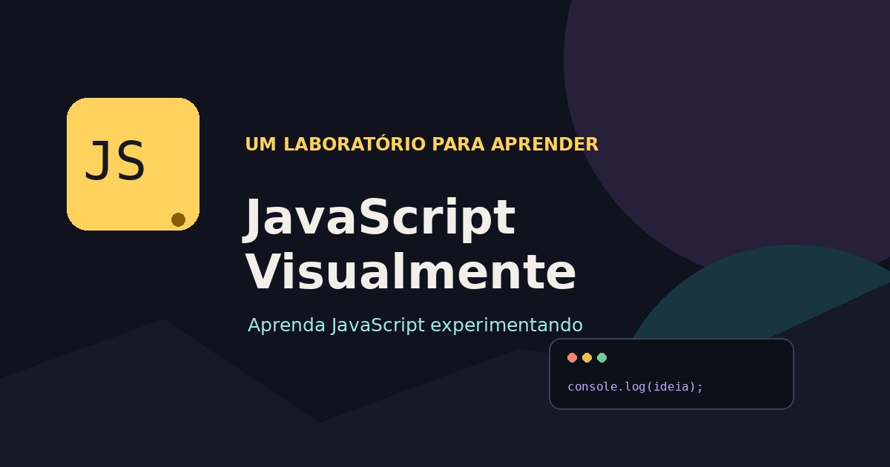

# JavaScript Visualmente

## Sobre o projeto

O **JavaScript Visualmente** é um site gratuito para aprender JavaScript praticando. Ele foi feito para quem está começando e quer entender o que o código faz sem precisar instalar programas.

No site, cada aula explica uma ideia de JavaScript e mostra um exemplo. Você pode alterar o código, clicar em **Rodar código** e ver o resultado na hora.

## O que dá para aprender

O site possui aulas sobre:

- `console.log`, variáveis e tipos de dados;
- contas, comparações e decisões com `if` e `else`;
- repetições com `for`;
- funções;
- arrays e objetos;
- JSON e dados de sensores;
- mudanças em páginas com DOM;
- tratamento de erros;
- `async`, `await` e promessas;
- ideias básicas de HTTP e APIs.

Os exemplos usam situações simples, como estoque, entregas, sensores e máquinas. Eles foram escritos para este projeto e apenas se inspiram nos temas estudados no [Curso SENAI](https://github.com/gabrielaraujo-eng/Curso_senai/tree/main/2_termo/BACKEND). Este site não é um material oficial do SENAI.

## O que é o playground?

O playground é a área em que você testa o código.

1. Escolha uma aula.
2. Leia a explicação.
3. Altere o código no editor.
4. Clique em **Rodar código**.
5. Observe a saída e tente o desafio proposto.

O código é executado dentro de uma área separada do site. Isso evita que o exemplo altere a página principal. O código digitado não é enviado para um servidor.

## Como usar o site

Você pode usar o site diretamente pelo navegador:

- [Abrir o JavaScript Visualmente no GitHub Pages](https://gabrielaraujo-eng.github.io/JavaScript-Visualmente/);
- [Baixar o projeto completo em formato ZIP](https://github.com/gabrielaraujo-eng/JavaScript-Visualmente/archive/refs/heads/main.zip).

O arquivo ZIP contém o site completo. Depois de baixar, extraia a pasta e abra o `index.html`. Para usar todas as aulas corretamente, prefira o link do GitHub Pages, porque ele já abre o projeto em um endereço web.
Ao abrir o site pelo GitHub Pages, o navegador pode oferecer a opção **Instalar app**. Use essa opção para adicionar o JavaScript Visualmente como aplicativo ao computador ou celular. Dependendo do navegador e do dispositivo, ela também pode aparecer como **Adicionar à tela inicial** no menu do navegador.

## Arquivos principais

- `index.html`: página principal do site.
- `public/style.css`: cores, tamanhos, layout e versão para celular.
- `public/script.js`: busca, filtros, tema, progresso e execução do código.
- `public/data/lessons.json`: textos e exemplos das aulas.
- `public/assets/`: favicon e banner usado nas redes sociais.
- `robots.txt` e `sitemap.xml`: arquivos que ajudam os buscadores a encontrar o site.
- `.github/workflows/pages.yml`: verificação automática dos arquivos do projeto.

O projeto usa apenas **HTML, CSS e JavaScript**. Não usa TypeScript, framework, banco de dados ou servidor próprio.

## GitHub Pages

O projeto já possui `index.html` na raiz, que é o formato esperado pelo GitHub Pages. A versão online está disponível em [gabrielaraujo-eng.github.io/JavaScript-Visualmente](https://gabrielaraujo-eng.github.io/JavaScript-Visualmente/). O workflow do projeto verifica os arquivos e não exige Python ou outra instalação para quem só quer usar o site.

## Referências visuais

A organização e a apresentação foram inspiradas por projetos do próprio autor:

- [Matemática Blitz](https://github.com/gabrielaraujo-eng/matematica-blitz);
- [Provão Paulista 2027](https://github.com/gabrielaraujo-eng/provao-paulista-2027);
- [Laboratório Visual de HTML & CSS](https://loboratorio-html.vercel.app/).

Projeto acadêmico e autoral de Gabriel Araújo.

## Outros projetos

Veja outros projetos do autor no [perfil de Gabriel Araújo no GitHub](https://github.com/gabrielaraujo-eng).
